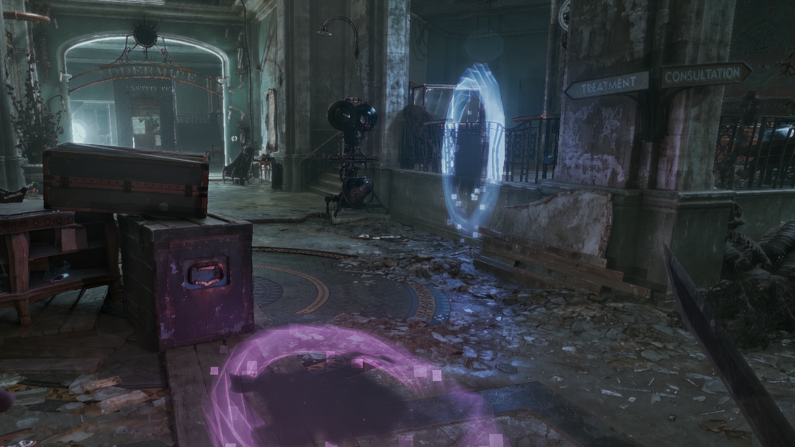
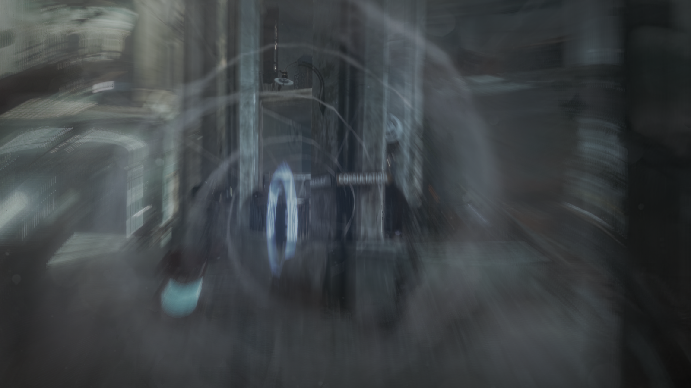
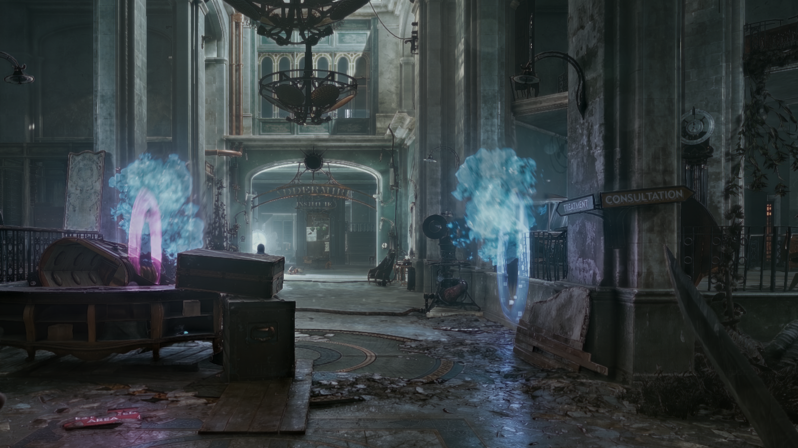

# Void Gate: a Portal-style power for Dishonored 2

**Void Gate** is a new power for Corvo and Emily: open two linked rifts into the Void on any wall, floor or
ceiling, step into one and come out of the other. You keep your speed and direction, so you can fall into a rift in
the floor and fly out of a rift in a wall, Portal style.

It is an unofficial fan mod. It plays like a power of the game: it has its own page and upgrade tree in the journal,
is bought with runes and sits on the power wheel. It uses the game's own animations, sounds and Void effects.

[Русская версия ниже](#врата-бездны-сила-в-стиле-portal-для-dishonored-2)

## Features

- **Two linked rifts.** Every cast opens a rift on the surface you look at: the first is the entrance, the second
  the exit. A new rift replaces the oldest one. Each rift costs 15 mana.
- **Momentum through rifts.** Run, jump or fall into a rift and you leave the other one at the same speed, turned
  the way the exit faces.
- **Opening and closing.** Rifts open and close with a Void burst and sound. Tap the interact key (F) to close both.
- **Escape.** If a rift strands you far below its exit (or under the level), the interact key also takes you back
  to where you entered.
- **Three upgrades** in the journal:

  | Upgrade | Runes | Effect |
  |---|---|---|
  | Void Gate | 4 | The power: two linked rifts, up to 20 m away |
  | Far Rift | 2 | Rifts can be opened twice as far away (40 m) |
  | Through the Void | 3 | Guards, bodies, bottles and grenades pass through rifts and keep their momentum |
  | Crossfire | 3 | Bolts, bullets and Windblast pass through rifts: shoot into one rift to hit whoever stands before the other |

- **Soft landing for NPCs.** A guard thrown through a rift is not killed by the fall that follows it.
- **All 11 languages of the game.** The other nine translations (French, German, Japanese...) are unofficial and
  use the game's own words for its powers and the Void. Corrections from native speakers are welcome.

| | |
|---|---|
|  |  |

## How to play

1. Open the journal, go to **Powers** and buy **Void Gate** for 4 runes.
2. Select it on the power wheel.
3. Hold the power button to aim: a marker shows where the rift will open. Release it to open the rift. Do it again
   for the second rift.
4. Walk, jump or fall into a rift.
5. Tap **F** (interact) to close both rifts.

## Install

You need Dishonored 2 for Windows. The mod was made and tested on the GOG version 1.77.9.0 (see
[Compatibility](#compatibility)).

1. Download `VoidGate-<version>.zip` from Nexus Mods or from
   [GitHub Releases](../../releases) and unzip it anywhere.
2. Close the game.
3. Run `VoidGateSetup.exe` and press **Next**. The setup finds the game folder by itself; if it does not, choose
   it with **Browse** (the folder with `Dishonored2.exe`).
4. Press **Install**.
5. Start the game, open the journal and buy Void Gate.

The setup adds Void Gate **on top of the mods you already have**. It understands the mod catalogs that Void
Installer writes. Before the first install it saves the game
files it changes to `base\voidgate_backup` in the game folder.

If you install or change other mods with Void Installer later, run `VoidGateSetup.exe` again. Void Installer
rebuilds the catalogs without Void Gate, and the setup adds it back.

## Uninstall

Run `VoidGate_Uninstall.exe` in the game folder, or run `VoidGateSetup.exe` and choose **Uninstall**. The game
folder goes back exactly to how it was before Void Gate. The uninstaller then removes itself.

If you installed other mods after Void Gate, the uninstaller warns you first. Going back to the state before
Void Gate removes those mods too, and you can install them again afterwards.

## Compatibility

- **Game version.** The mod is tested only on **GOG 1.77.9.0**. Other versions (Steam, Microsoft Store, other
  patches) have **not been tested**. At every start the mod checks the 66 places of the game's code it uses. If any
  of them differs, the mod turns itself off and shows a message, and the game runs normally without it. The setup
  runs the same check before installing and tells you the result. If your version passes, the mod should work,
  but nobody has tried it yet. A report on Nexus or GitHub is welcome.
- **Other mods.** Data mods installed with Void Installer keep working. A mod that changes the same game files
  (the power list, the inventory list, the power-wheel texture or the text files) may conflict. Void Gate's changes
  are applied last.
- **`dinput8.dll`.** The mod loads through `dinput8.dll` in the game folder. If another mod already uses that file,
  the setup keeps a copy and puts it back on uninstall, but that mod does not run while Void Gate is installed.
- **Saves.** The mod does not change how saving works. After uninstalling, saves made with Void Gate still load
  (tested): the power simply disappears from them.
- **Death of the Outsider** is a separate game and is not supported.

## Known limitations

- **Mission 7 (A Crack in the Slab).** The game has no free slot on the power wheel, so Void Gate uses the
  Timepiece's slot. While you carry the Timepiece, both share that slot and the wheel shows the Void Gate icon.
  Choose the slot once for the Timepiece and again for Void Gate.
- **No view through a rift.** A see-through window was made but is off: it flickered and cost frame rate.
- **Rifts outside the level.** A rift can be opened on a surface whose other side is outside the playable level.
  If you fall under the map, tap F to go back to the entrance.

## Building from source

- `native_d2/`: the native part in C. `dinput8.dll` is a proxy loaded by the game that installs the hooks;
  `voidgate.dll` is the gameplay module (rifts, passage, upgrades, aiming). Build it with `native_d2\build.cmd`
  (uses [Zig](https://ziglang.org/) as the C compiler, expected in `toolchain\zig`). Offline tests of the rift
  math: `native_d2\build.cmd test`.
- `d2mods/VoidGate/`: the data mod (`files/` = game resources added or changed, `lang/` = texts, `mod.json` =
  index entries). The generators `tools/make_voidgate_*.py` produce most of it from the game's own files, which are
  not included here.
- `tools/vg_setup.py`: the setup. `tools/vg_build.py` builds the native part, the payload and
  `release/VoidGateSetup.exe` (needs [PyInstaller](https://pyinstaller.org/)).
- `tools/make_sig.py`: makes `native_d2/vg_sig.h`, the code checks of the supported game build.
- `docs/`: research notes on the engine (raycasts, NPC falls, the portal renderer, cut content) and the test setup.

## Credits and license

The code is under the [MIT license](LICENSE).

Dishonored is a trademark of ZeniMax Media. This is an unofficial fan mod, not made or endorsed by Arkane Studios
or Bethesda. The mod contains no copies of the game's assets beyond small edited game declarations and the
power-wheel texture with the Void Gate icon added. Other game resources it needs are taken from your own copy of
the game at install time.

---

# Врата Бездны: сила в стиле Portal для Dishonored 2

**Врата Бездны** — новая сила для Корво и Эмили. Откройте два связанных разлома в Бездну на любой стене, полу или
потолке, войдите в один и выйдите из другого. Скорость и направление сохраняются: можно упасть в разлом в полу и
вылететь из разлома в стене, как в Portal.

Это неофициальный фанатский мод. Сила работает как родная: своя страница и дерево улучшений в журнале, покупка за
руны, место на колесе сил. Анимации, звуки и эффекты Бездны взяты из самой игры.

## Возможности

- **Два связанных разлома.** Каждое применение открывает разлом там, куда вы смотрите: сначала вход, затем выход.
  Новый разлом заменяет самый старый. Разлом стоит 15 маны.
- **Импульс сквозь разлом.** Разбегитесь, прыгните или упадите в разлом, и вы вылетите из другого с той же
  скоростью, развёрнутые по выходу.
- **Открытие и закрытие** со вспышкой Бездны и звуком. Короткое нажатие F закрывает оба разлома.
- **Возврат.** Если разлом завёл вас далеко вниз от выхода или под уровень, F вернёт вас к месту входа.
- **Три улучшения:** «Дальний разлом» (2 руны, дальность вдвое больше: 40 м вместо 20), «Сквозь Бездну» (3 руны:
  стражники, тела, бутылки и гранаты проходят сквозь разломы), «Перекрёстный огонь» (3 руны: болты, пули и Порыв
  ветра проходят сквозь разломы). Сама сила стоит 4 руны.
- **Мягкое приземление NPC.** Стражник, брошенный сквозь разлом, не разбивается при падении после него.
- **Все 11 языков игры.** Переводы на остальные девять языков (французский, немецкий, японский и т. д.)
  неофициальные и используют те же названия сил и Бездны, что и сама игра. Поправки от носителей языка приветствуются.

## Как играть

1. Журнал → **Умения** → купите **Врата Бездны** за 4 руны.
2. Выберите силу на колесе сил.
3. Зажмите кнопку силы, чтобы прицелиться: метка покажет, где откроется разлом. Отпустите, чтобы открыть его.
   Повторите для второго разлома.
4. Войдите, прыгните или упадите в разлом.
5. Короткое нажатие **F** закрывает оба разлома.

## Установка

1. Скачайте `VoidGate-<версия>.zip` с Nexus Mods или из [GitHub Releases](../../releases) и распакуйте куда
   угодно.
2. Закройте игру.
3. Запустите `VoidGateSetup.exe` и нажмите **Далее**. Установщик сам найдёт папку игры; если нет, выберите её
   кнопкой **Обзор** (папка с `Dishonored2.exe`).
4. Нажмите **Установить**.
5. Запустите игру и купите Врата Бездны в журнале.

Установщик добавляет Врата **поверх уже установленных модов**, в том числе поставленных через Void Installer. Перед
первой установкой он сохраняет изменяемые файлы игры в `base\voidgate_backup` в папке игры. Если позже
ставите или меняете моды через Void Installer, запустите `VoidGateSetup.exe` ещё раз: Void Installer пересобирает
каталоги без Врат, а установщик вернёт их.

## Удаление

Запустите `VoidGate_Uninstall.exe` в папке игры или `VoidGateSetup.exe` → **Удалить**. Папка игры станет
точно такой, какой была до установки Врат, после чего деинсталлятор удалит сам себя. Если после Врат вы ставили
другие моды, деинсталлятор сначала предупредит: возврат к состоянию до Врат уберёт и их, их можно будет поставить
заново.

## Совместимость

- **Версия игры.** Мод проверен только на **GOG 1.77.9.0**. Другие версии (Steam, Microsoft Store, другие патчи)
  **не проверялись**. При каждом запуске мод сверяет 66 мест кода игры, которые он использует. Если хоть одно
  отличается, мод выключается сам и показывает сообщение, а игра работает как обычно, просто без него. Установщик
  делает ту же проверку перед установкой и сообщает результат. Если ваша версия проходит проверку, мод должен
  работать, но никто этого ещё не пробовал. Будем рады отчёту на Nexus или GitHub.
- **Другие моды.** Моды, поставленные через Void Installer, продолжают работать. Конфликт возможен с модом, который
  меняет те же файлы: список сил, список предметов, текстуру колеса сил или файлы текстов. Изменения Врат
  применяются последними.
- **`dinput8.dll`.** Мод загружается через `dinput8.dll` в папке игры. Если этот файл уже занят другим модом,
  установщик сохранит его копию и вернёт при удалении, но пока стоят Врата, тот мод работать не будет.
- **Сохранения.** Мод не меняет то, как игра сохраняется. После удаления мода сохранения с Вратами загружаются
  (проверено), сила из них просто пропадает.
- **Death of the Outsider** — отдельная игра, она не поддерживается.

## Известные ограничения

- **Миссия 7 (особняк Стилтона).** Свободного слота на колесе сил в игре нет, поэтому Врата занимают слот Часов.
  Пока у вас есть Часы, они делят этот слот с Вратами, и на колесе видна иконка Врат. Выберите слот один раз, чтобы
  взять Часы, и ещё раз, чтобы взять Врата.
- **Сквозь разлом не видно другую сторону.** Окно было сделано, но выключено: оно мерцало и снижало FPS.
- **Разлом за пределами уровня.** Разлом можно открыть на поверхности, за которой нет уровня. Если провалились под
  карту, нажмите F, чтобы вернуться ко входу.

Код распространяется по лицензии MIT. Dishonored — торговая марка ZeniMax Media. Это неофициальный фанатский мод,
не связанный с Arkane Studios и Bethesda.
